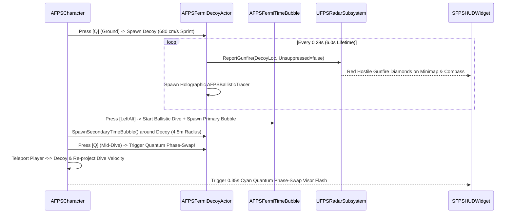

# THE FERMI PARADOX ENGINE // TECHNICAL ARCHITECTURE & PHYSICS SPECIFICATION

> **Subsystem**: Phase 8A & 8B — 3rd-Person OTS Camera Overhaul, Omnidirectional Ballistic Dive, Localized Chrono-Dilation Field, Acoustic Hologram Echo & Mid-Air Quantum Phase-Swap  
> **Module**: `Source/NobleFermi/Character/` & `Source/NobleFermi/Combat/`  
> **Engine**: Unreal Engine 5.8 (C++20, 128 Hz Tickrate, Lumen Real-Time Illumination)

---

## 1. Executive Summary & Core Combat Loop

**The Fermi Paradox Engine** transforms the title **Noble Fermi** from a code-name into the literal physics core of the shooter. By combining **Max Payne 3 / Superhot-inspired Omnidirectional Time-Dilation Dives** with **Acoustic Hologram Decoys & Mid-Air Quantum Phase-Swapping**, every 128-tick firefight on **Rust Tactical** becomes a high-dopamine tactical puzzle of space, acoustics, and relativistic time manipulation.

```
┌────────────────────────────────────────────────────────────────────────────────────────┐
│                              THE FERMI PARADOX ENGINE                                  │
│                  "Dive, Clone, Swap, Shatter Time" Combat Architecture                 │
└────────────────────────────────────────────────────────────────────────────────────────┘
            │                                 │                                  │
            ▼                                 ▼                                  ▼
┌───────────────────────────┐   ┌───────────────────────────┐   ┌───────────────────────────┐
│  1. ACOUSTIC FERMI ECHO   │   │  2. MAX PAYNE DIVE &      │   │  3. MID-AIR QUANTUM       │
│        (Press [Q])        │   │     CHRONO FIELD ([ALT])  │   │     PHASE-SWAP (Press [Q])│
├───────────────────────────┤   ├───────────────────────────┤   ├───────────────────────────┤
│ • Spawns SK_BaseMale      │   │ • Omnidirectional Launch  │   │ • Instant World Transform │
│   phosphor-cyan hologram  │   │   (820 cm/s H, 340 cm/s V)│   │   Exchange (Player<->Echo)│
│ • Sprints at 680 cm/s     │   │ • 75° Directional Tilt    │   │ • Conserves & Re-projects │
│   with wall deflection    │   │   + 0.45s Landing Slide   │   │   Dive Momentum Along Aim │
│ • Fires unsuppressed AK47 │   │ • 4.5m Chrono Sphere:     │   │ • Dual 4.5m Time Bubbles  │
│   bursts every 0.28s      │   │   Enemies: 0.25x Speed    │   │   (Player + Echo)         │
│ • Floods enemy Radar &    │   │   Operator: 0.55x Reflex  │   │ • 0.35s Cyan Visor Phase  │
│   Compass with red blips  │   │ • 2,800 cm/s Brass Tracers│   │   Telemetry Flash         │
└───────────────────────────┘   └───────────────────────────┘   └───────────────────────────┘
```

### The 3-Act Tactical Firefight Loop on Rust Tactical
1. **Act I — Acoustic Deception (`[Q]` on Ground)**:
   Pinned behind the concrete Jersey barriers at Flag B while a sniper hard-scopes the lane from the Oil Derrick catwalk, you tap `Q`. An **Acoustic Fermi Echo** (`AFPSFermiDecoyActor`)—a glowing phosphor-cyan hologram of your 21-bone `SK_BaseMale` operator holding an `SM_AK47`—sprints out at $680\text{ cm/s}$ from your active shoulder side, firing simulated unsuppressed bursts every $0.28\text{ s}$ that broadcast hostile red threat diamonds across enemy minimaps and compass tapes via `UFPSRadarSubsystem`.
2. **Act II — Omnidirectional Ballistic Dive & Chrono Field (`[LeftAlt]` or `Move + [C]` / `[Ctrl]+[Space]`)**:
   As the enemy swings their aim to engage your hologram decoy, you launch into a **3rd-Person Omnidirectional Ballistic Dive** out the opposite side of cover—or straight off a shipping container roof. Leaving your feet consumes $35.0$ Stamina, tilts your 21-bone operator $75^\circ$ into the dive vector with full $360^\circ$ mid-air aiming, and expands a **4.5-meter Fermi Time-Dilation Field** (`AFPSFermiTimeBubble`) around both you **and** your active Decoy.
3. **Act III — Relativistic Bullet-Time & Mid-Air Quantum Swap (`[Q]` Mid-Dive)**:
   Inside the 4.5-meter sphere, enemy pawns and incoming projectiles drop to **$25\%$ speed** (`CustomTimeDilation = 0.25f`), while the diving operator operates at **$55\%$ reflex speed** (`0.55f`) with $1:1$ un-dilated mouse rotation compensation. Fired rounds materialize as physicalized **brass ballistic slugs** (`AFPSBallisticTracer`) slicing through 3D space at $2,800\text{ cm/s}$ with electric cyan/amber wake trails. Tapping `Q` while airborne in slow-motion executes an instant **Quantum Phase-Swap**, exchanging world positions with your Fermi Echo while conserving and redirecting your ballistic dive velocity along your sightline.

---

## 2. 3rd-Person Over-The-Shoulder (OTS) Camera & Hybrid Optic Rig

Implemented in [`AFPSCharacter`](file:///c:/Users/Boris/Documents/antigravity/noble-fermi/Source/NobleFermi/Character/FPSCharacter.h) (`UpdateThirdPersonCamera`), the camera system combines *Ghost Recon / Max Payne 3* over-the-shoulder spatial awareness with instant corner-peeking and hybrid first-person optic precision.

### 2.1 Camera States & Kinematic Parameters

| Camera State | Trigger | Target Arm Length ($\ell$) | Socket Offset $(X, Y, Z)\text{ cm}$ | Field of View ($\text{FOV}$) | Interpolation Speed |
| :--- | :--- | :--- | :--- | :--- | :--- |
| **Standard 3P OTS (Hipfire / Sprint)** | Default | $210.0\text{ cm}$ | $(0.0,\; 52.0 \cdot s,\; 22.0)$ | $90.0^\circ$ | $14.0\text{ s}^{-1}$ |
| **Tight 3P OTS ADS** | Hold `RMB` | $95.0\text{ cm}$ | $(0.0,\; 34.0 \cdot s,\; 16.0)$ | $62.0^\circ$ | $14.0\text{ s}^{-1}$ |
| **Hybrid 1P True Optic ADS** | `MMB` while holding `RMB` | $0.0\text{ cm}$ | $(28.0,\; 12.0 \cdot s,\; 4.0)$ | $55.0^\circ$ | $14.0\text{ s}^{-1}$ |
| **Ballistic Dive Framing** | Airborne Dive | $225.0\text{ cm}$ | $(0.0,\; 52.0 \cdot s,\; 22.0)$ | $94.0^\circ$ | $14.0\text{ s}^{-1}$ |
| **Ragdoll Pelvis Track** | $HP \le 0$ | $240.0\text{ cm}$ | Attached to `pelvis` | $90.0^\circ$ | $6.0\text{ s}^{-1}$ |

Where $s \in [-1.0, +1.0]$ is the continuous **`ShoulderSideMultiplier`**, smoothly interpolated via `V` (`ToggleShoulderSwap`):

$$s(t + \Delta t) = \text{FInterpTo}\!\left(s(t),\; s_{\text{target}},\; \Delta t_{\text{real}},\; 10.0\right), \quad s_{\text{target}} = \begin{cases} +1.0 & \text{Right Shoulder} \\ -1.0 & \text{Left Shoulder} \end{cases}$$

### 2.2 Anti-Whiteout Exposure & Collision Probe
- **Collision Protection**: `CameraBoom->bDoCollisionTest = true` with `ProbeSize = 12.0f` cm prevents the camera from clipping through shipping containers, oil derrick girders, or bunker walls.
- **Lumen Exposure Lock**: `FollowCamera` enforces `EAutoExposureMethod::AEM_Manual` with `AutoExposureBias = 0.0f` and `BloomIntensity = 0.1f`, guaranteeing that translucent/emissive chrono fields and holographic decoys never cause screen whiteout.

---

## 3. Max Payne Omnidirectional Ballistic Dive & Posture Kinematics

Implemented across [`UFPSCharacterMovementComponent`](file:///c:/Users/Boris/Documents/antigravity/noble-fermi/Source/NobleFermi/Character/FPSCharacterMovementComponent.h) and [`AFPSCharacter`](file:///c:/Users/Boris/Documents/antigravity/noble-fermi/Source/NobleFermi/Character/FPSCharacter.cpp).

### 3.1 Trigger Inputs & Stamina Gate
A Ballistic Dive can be triggered while on the ground via any of three ergonomic input chords:
1. Pressing **`LeftAlt`** (`BallisticDive` action) while moving in any `WASD` direction (or neutral for a forward dive).
2. Holding **`C` / `LeftControl`** while moving and pressing **`SpaceBar`**.
3. **Double-tapping `C`** ($\Delta t \le 0.32\text{ s}$) while moving in any `WASD` direction.

**Stamina Requirements**:
- Minimum Stamina required to initiate: $S_{\min} = 25.0$
- Stamina consumed on launch: $\Delta S_{\text{dive}} = 35.0$
- Post-dive cooldown: $T_{\text{cd}} = 1.2\text{ s}$

### 3.2 Parabolic Launch Trajectory & Landing Slide
Given the normalized 2D world dive direction $\hat{\mathbf{d}}_{2D} = \frac{(v_x, v_y, 0)}{\|(v_x, v_y, 0)\|}$ derived from the player's current `WASD` input vector, the movement mode transitions immediately to `MOVE_Falling` (`EFPSMovementMode::BallisticDiving`) with initial velocity:

$$\mathbf{v}_{\text{launch}} = V_{\text{horiz}}\,\hat{\mathbf{d}}_{2D} + V_{\text{vert}}\,\hat{\mathbf{k}} = 820.0\,\hat{\mathbf{d}}_{2D} + (0, 0, 340.0)\text{ cm/s}$$

Upon ground re-contact (`IsMovingOnGround()` after leaving the ground), the character seamlessly enters a **$0.45\text{ s}$ Kinetic Prone Landing Slide**:

$$\mathbf{v}_{\text{slide}}(0) = 0.65 \cdot V_{\text{horiz}}\,\hat{\mathbf{d}}_{2D} = 533.0\,\hat{\mathbf{d}}_{2D}\text{ cm/s}$$

During the $0.45\text{ s}$ slide window, velocity decays smoothly via `FMath::VInterpTo(..., 4.5f)` before `StopBallisticDive()` returns the operator to upright tactical locomotion.

### 3.3 Omnidirectional $75^\circ$ 3D Body Tilt & $360^\circ$ Mid-Air Aiming
While airborne and sliding, the operator retains **full $360^\circ$ mouse yaw/pitch aiming** (`bUseControllerRotationYaw = true`) and reduced weapon spread ($0.45\times$ bloom). To keep the 21-bone `SK_BaseMale` body physically aligned with the world-space dive trajectory regardless of which direction the player turns their aim in mid-air, `UpdateBallisticDivePosture` projects the world dive unit vector $\hat{\mathbf{d}}_{2D}$ onto the character's instantaneous horizontal basis $(\hat{\mathbf{f}}_{2D}, \hat{\mathbf{r}}_{2D})$:

$$\alpha_{\text{fwd}} = \hat{\mathbf{d}}_{2D} \cdot \hat{\mathbf{f}}_{2D}, \qquad \alpha_{\text{right}} = \hat{\mathbf{d}}_{2D} \cdot \hat{\mathbf{r}}_{2D}$$

Because `SK_BaseMale` is mounted with a base relative Yaw of $-90^\circ$ (aligning mesh $+Y$ with character forward $+X$), the target relative `FRotator(Pitch, Yaw, Roll)` for a tilt angle $\theta_{\text{dive}} \in [72^\circ, 78^\circ]$ is:

$$\text{Roll}_{\text{target}} = \alpha_{\text{fwd}} \cdot \theta_{\text{dive}}, \qquad \text{Pitch}_{\text{target}} = -\alpha_{\text{right}} \cdot \theta_{\text{dive}}, \qquad \text{Yaw}_{\text{target}} = -90.0^\circ$$

- **Forward Dive ($\alpha_{\text{fwd}} = +1$)**: Operator pitches $75^\circ$ chest-down horizontal, aiming over the barrel.
- **Backward Dive ($\alpha_{\text{fwd}} = -1$)**: Operator pitches $-75^\circ$ supine onto their back, firing forward between/above their knees (*Max Payne 3* style).
- **Lateral Left/Right Dive ($\alpha_{\text{right}} = \pm 1$)**: Operator rolls $\pm 75^\circ$ onto their side while tracking targets across a $360^\circ$ hemisphere.

---

## 4. Localized "Fermi Time-Dilation Field" (`AFPSFermiTimeBubble`)

Defined in [`FPSFermiTimeBubble.h`](file:///c:/Users/Boris/Documents/antigravity/noble-fermi/Source/NobleFermi/Combat/FPSFermiTimeBubble.h) and [`FPSFermiTimeBubble.cpp`](file:///c:/Users/Boris/Documents/antigravity/noble-fermi/Source/NobleFermi/Combat/FPSFermiTimeBubble.cpp).

### 4.1 Differential Relativistic Time Dilation
Unlike global `UGameplayStatics::SetGlobalTimeDilation` (which breaks multiplayer synchronization by slowing the entire server), `AFPSFermiTimeBubble` applies **localized per-actor `CustomTimeDilation`** strictly to actors overlapping its $R = 450.0\text{ cm}$ ($4.5\text{ m}$) radius for $T_{\text{bubble}} = 2.4\text{ s}$ of real-world time:

$$\gamma(\mathbf{x}, A) = \begin{cases} \gamma_{\text{owner}} = 0.55 & \text{if } \|\mathbf{x}_A - \mathbf{x}_{\text{bubble}}\| \le 450\text{ cm and } A = \text{BubbleOwner} \\ \gamma_{\text{enemy}} = 0.25 & \text{if } \|\mathbf{x}_A - \mathbf{x}_{\text{bubble}}\| \le 450\text{ cm and } A \neq \text{BubbleOwner} \\ 1.00 & \text{if } \|\mathbf{x}_A - \mathbf{x}_{\text{bubble}}\| > 450\text{ cm} \end{cases}$$

- **Real-Time Clock Independence**: Because the bubble is attached to the diving owner ($\gamma_{\text{owner}} = 0.55$), `AFPSFermiTimeBubble::Tick` recovers true un-dilated wall-clock time via:
  $$\Delta t_{\text{real}} = \frac{\Delta t_{\text{tick}}}{\max(0.05,\; \text{GetActorTimeDilation}())}$$
- **Inverse Time-Dilation Mouse Compensation**: In `AFPSCharacter::Turn` and `AFPSCharacter::LookUp`, angular mouse input is multiplied by $\gamma_{\text{owner}}^{-1} = \frac{1}{\text{CustomTimeDilation}}$ so the player's $360^\circ$ crosshair tracking remains $100\%$ crisp and un-sluggish during slow motion.
- **Deterministic Cleanup**: `DilatedActors` stores weak pointers (`TSet<TWeakObjectPtr<AActor>>`) to every affected `APawn`, `AFPSProjectileBase`, and `AFPSBallisticTracer`. Exiting the $450\text{ cm}$ sphere or destroying the bubble (`EndPlay`) immediately restores `CustomTimeDilation = 1.0f`.

### 4.2 Physicalized Slow-Motion Ballistic Tracers (`AFPSBallisticTracer`)
Defined in [`FPSBallisticTracer.h`](file:///c:/Users/Boris/Documents/antigravity/noble-fermi/Source/NobleFermi/Combat/FPSBallisticTracer.h) and [`FPSBallisticTracer.cpp`](file:///c:/Users/Boris/Documents/antigravity/noble-fermi/Source/NobleFermi/Combat/FPSBallisticTracer.cpp).
- Whenever `AFPSWeaponBase::FireShot()` executes, it spawns an `AFPSBallisticTracer` consisting of a $14\text{ cm}$ glowing brass slug (`BrassSlugMesh`) and a $110\text{ cm}$ wake streak (`WakeTrailMesh`).
- When fired inside or passing through an active `AFPSFermiTimeBubble`, tracer speed drops to $V_{\text{dilated}} = 2,800\text{ cm/s}$ (and is further scaled by $\gamma_{\text{enemy}} = 0.25$ inside the bubble), letting operators watch bullets slice through the air in 3rd-person slow motion.

### 4.3 Piecewise Hitscan-to-Slug Conversion (`AFPSDilatedBulletActor`)
Defined in [`FPSDilatedBulletActor.h`](file:///c:/Users/Boris/Documents/antigravity/noble-fermi/Source/NobleFermi/Weapons/FPSDilatedBulletActor.h) and [`FPSDilatedBulletActor.cpp`](file:///c:/Users/Boris/Documents/antigravity/noble-fermi/Source/NobleFermi/Weapons/FPSDilatedBulletActor.cpp).
- **The Infinite-Speed Ray Paradox**: Standard instantaneous hitscan rays travel at infinite velocity ($\infty \cdot 0.25 = \infty$), which would instantly eliminate players inside a slow-motion field without affording reaction time.
- **Piecewise Conversion Logic**:
  1. **Shooter Inside Fermi Bubble**: When firing from inside an active bubble, hitscan is suppressed immediately at the barrel. In its place, an `AFPSDilatedBulletActor` spawns traveling at $1,400\text{ cm/s}$ ($14\text{ m/s}$) with a per-frame continuous sphere sweep ($R = 5\text{ cm}$) and bone damage zoning via `UFPSHealthComponent`.
  2. **Shooter Outside, Firing Into Fermi Bubble**: `AFPSFermiTimeBubble::FindEarliestBubbleEntry` performs ray-sphere intersection testing. If the hitscan ray intersects an active 4.5m bubble horizon *before* striking world geometry, the hitscan terminates at the exact entry coordinate $\mathbf{x}_{\text{entry}}$, an `AFPSBallisticTracer` connects the muzzle to $\mathbf{x}_{\text{entry}}$, and an `AFPSDilatedBulletActor` spawns cruising inward across the bubble at $1,400\text{ cm/s}$.
  3. **Bubble Horizon Exit**: If a dilated slug traverses the entire 4.5m bubble without colliding with an actor or obstacle, it executes `ExecuteRemainderHitscan()`, projecting a standard instantaneous hitscan trace along its forward vector for the remaining range ($R_{\text{rem}} = R_{\max} - d_{\text{traveled}}$) and self-destructing cleanly.


---

## 5. "Fermi Echo" Acoustic Hologram Decoy & Quantum Phase-Swap (`AFPSFermiDecoyActor`)

Defined in [`FPSFermiDecoyActor.h`](file:///c:/Users/Boris/Documents/antigravity/noble-fermi/Source/NobleFermi/Combat/FPSFermiDecoyActor.h) and [`FPSFermiDecoyActor.cpp`](file:///c:/Users/Boris/Documents/antigravity/noble-fermi/Source/NobleFermi/Combat/FPSFermiDecoyActor.cpp).



### 5.1 Autonomous Traversal & Acoustic Radar Spoofing
- **Skeletal & Weapon Fidelity**: Renders `SK_BaseMale` with `SM_AK47` socketed to `weapon_r`, playing `Anim_BaseMale_Run` / `Anim_BaseMale_Sprint` at $1.25\times$ rate with a glowing phosphor-cyan holographic material instance.
- **Surface-Conforming Sprint & Wall Deflection**: Every tick, `AFPSFermiDecoyActor` advances at $680\text{ cm/s}$. Forward line-traces detect obstacles within $75\text{ cm}$ and project the sprint direction along the wall tangent ($\mathbf{d}' = \text{ Normalize2D}(\mathbf{d} - (\mathbf{d}\cdot\hat{\mathbf{n}})\hat{\mathbf{n}})$), while downward line-traces snap the hologram cleanly to ramps, catwalks, and terrain.
- **Radar & Compass Saturation**: Every $0.28\text{ s}$, `FireAcousticBurst()` reports unsuppressed gunfire to `UFPSRadarSubsystem` and fires a cyan holographic tracer downrange.

### 5.2 Mid-Air Quantum Phase-Swap Conservation Laws
When `TriggerFermiEchoOrQuantumSwap()` is invoked while `IsFermiDecoyActive()` is true:
1. **Positional Exchange**:
   $$\mathbf{x}_{\text{player}}^{\text{new}} = \mathbf{x}_{\text{decoy}}^{\text{old}}, \qquad \mathbf{x}_{\text{decoy}}^{\text{new}} = \mathbf{x}_{\text{player}}^{\text{old}}$$
2. **Momentum Conservation & Aim Re-Projection**:
   If the player is mid-dive (`IsBallisticDiving()`), horizontal speed $\|\mathbf{v}_{2D}\|$ is preserved (clamped to at least $620\text{ cm/s}$) and redirected along the player's instantaneous control rotation unit vector $\hat{\mathbf{c}}_{2D}$, with an upward vertical floor $v_z \ge 180\text{ cm/s}$ to extend mid-air hang-time after materializing behind the enemy:
   $$\mathbf{v}_{\text{player}}^{\text{new}} = \max\!\left(\|\mathbf{v}_{2D}^{\text{old}}\|,\; 620.0\right)\hat{\mathbf{c}}_{2D} + \max\!\left(v_z^{\text{old}},\; 180.0\right)\hat{\mathbf{k}}$$

---

## 6. Slate C++ HUD Chrono & Quantum Telemetry (`SFPSHUDWidget`)

Implemented in [`FPSHUDWidget.h`](file:///c:/Users/Boris/Documents/antigravity/noble-fermi/Source/NobleFermi/UI/FPSHUDWidget.h) and [`FPSHUDWidget.cpp`](file:///c:/Users/Boris/Documents/antigravity/noble-fermi/Source/NobleFermi/UI/FPSHUDWidget.cpp):
1. **Bottom-Left `FERMI DIVE // CHRONO FIELD` Bar**:
   - **Ready**: `FERMI DIVE // [READY - ALT / DIVE]` rendered in glowing phosphor teal (`#00F0DC`).
   - **Active**: `FERMI DIVE // [ACTIVE // 0.25x TIME DILATION 2.4s]` with a pulsing cyan progress bar.
   - **Recharging / Low Stamina**: Amber recharge progress bar or crimson stamina warning (`< 25%`).
2. **Bottom-Right Tactical Slot (`[Q]` Readout)**:
   - Dynamically transitions between `[Q] DEPLOY FERMI ECHO`, `[Q] QUANTUM SWAP READY (6.0s)` in emerald green, and `[Q] ECHO COOLDOWN`.
3. **Peripheral Chrono Vignette & Digital Chronometer**:
   - While inside an active Fermi Time Bubble, renders a 4-edge translucent cyan visor vignette and a centered digital chronometer banner (`CHRONO FIELD // 0.25x c [2.40s]`), plus a `>> QUANTUM PHASE-SWAP COMPLETE <<` visor flash on swap execution.
