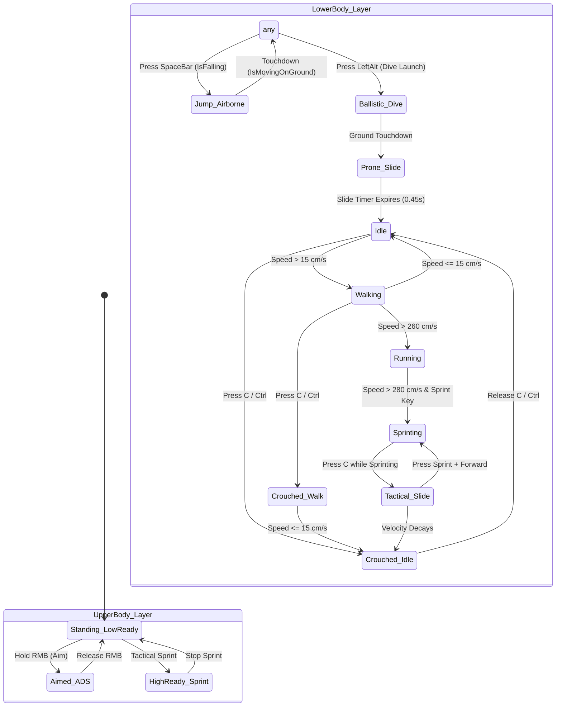
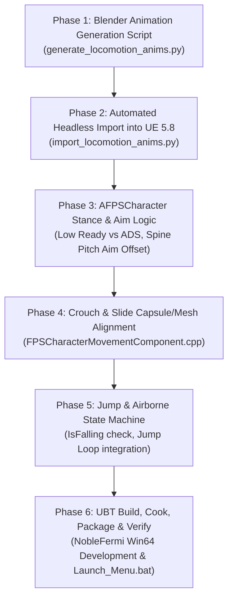

# PLAYER LOCOMOTION, WEAPON STANCES & KINEMATICS // TECHNICAL PLAN & IMPLEMENTATION ROADMAP

> **Subsystem**: Operator Animation, Full-Body 3rd-Person Locomotion, Weapon Stances & Kinetic Mobility  
> **Module**: `Source/NobleFermi/Character/` & `Content/Characters/BaseMale/`  
> **Target Branch**: `body-v1`  
> **Engine**: Unreal Engine 5.8 (C++20, 128 Hz Tickrate, Lumen Dynamic Illumination)  
> **Date**: October 16, 2026  

---

## 1. Executive Summary & Objective

The objective of this specification is to evolve the 21-bone `SK_BaseMale` operator holding the 3D `SM_AK47` rifle from a static demonstration mesh into a responsive, AAA-quality **3rd-Person Tactical Locomotion & Weapon Stance System**.

```
┌────────────────────────────────────────────────────────────────────────────────────────┐
│                      TACTICAL OPERATOR LOCOMOTION ARCHITECTURE                         │
│                     Layered Upper/Lower Body Split (Bone: spine_01)                    │
└────────────────────────────────────────────────────────────────────────────────────────┘
                                    │
          ┌─────────────────────────┴─────────────────────────┐
          ▼                                                   ▼
┌───────────────────────────────────┐   ┌───────────────────────────────────┐
│     LOWER BODY (Pelvis Down)      │   │     UPPER BODY (spine_01 Up)      │
│   Directional Ground & Air Base   │   │   Weapon Stance & Pitch Aiming    │
├───────────────────────────────────┤   ├───────────────────────────────────┤
│ • 8-Way Locomotion (Walk/Run/Spr) │   │ • Low Ready Stance (Hipfire)      │
│ • Backward & Strafe Translation   │   │ • Aimed ADS Stance (Hold RMB)     │
│ • Crouch Idle & Low Stalk Walk    │   │ • Procedural Spine Pitch (±89°)   │
│ • Tactical Knee Slide (950 cm/s)  │   │ • Weapon Recoil Kick & Flinch     │
│ • In-Air Jump Tuck & Land Absorb  │   │ • 1:1 Contact on weapon_r Socket  │
│ • Max Payne Ballistic Dive Launch │   │ • 360° Mid-Air Weapon Tracking    │
└───────────────────────────────────┘   └───────────────────────────────────┘
```

The operator will seamlessly support **5 core movement and posture pillars**:
1. **Lowering & Aiming the Weapon**: Automatic transition between tactical **Low Ready** (weapon lowered across chest, pointing down-forward) and **Aimed ADS** (shoulder-mounted sightline alignment), with continuous upper-body spine pitch tracking mouse elevation from $-89^\circ$ to $+89^\circ$.
2. **8-Directional Locomotion**: True forward, backward, and lateral strafing with stride-matched play rates, eliminating moonwalking.
3. **Airborne Jump & Land Dynamics**: Anticipation, in-air apex tuck holding the rifle steady, and ground impact knee absorption.
4. **Tactical Crouch & Low Stalk**: Dynamic capsule half-height compression ($96\text{ cm} \to 48\text{ cm}$) paired with true crouched idle and crouch-walk animations with zero ground clipping.
5. **Tactical Sprint Knee Slide**: High-speed slide entry ($950\text{ cm/s}$) with reclined torso, extended lead leg, camera drop, and seamless exit into crouch or sprint.

---

## 2. Current State & Technical Gap Analysis

| Feature | Current Implementation Status | Gap / Defect in Current Build | Root Cause |
| :--- | :--- | :--- | :--- |
| **Weapon Lowering vs Aiming** | `Anim_BaseMale_Idle_ADS` and `Anim_BaseMale_LowReady` exist in Content folder. | In gameplay, the player is **always aiming down sights**, even when walking or standing idle. Weapon never lowers. | `AFPSCharacter::BeginPlay` never loads `Anim_BaseMale_LowReady`. `UpdateLocomotionAnimation` unconditionally forces `AnimIdleADS` at idle. |
| **Upper-Body Pitch Tracking** | Static weapon tilt clamped to a tiny $\pm 12^\circ$ roll on root mesh. | When looking up/down, arms and rifle stay horizontal. Crosshair points at the sky/dirt while rifle aims forward. | No procedural Aim Offset or spine bone pitch rotation applied to `spine_01`, `spine_02`, `spine_03`, `neck_01`, `head`. |
| **Directional Locomotion** | 1D forward Walk, Run, and Sprint with speed-scaled play rates. | Pressing `S` (backward) or `A`/`D` (strafe) plays forward walk/run animation while gliding backward/sideways (moonwalking). | `UpdateLocomotionAnimation` only inspects scalar speed `Speed = GetVelocity().Size2D()`. Velocity direction angle relative to actor yaw is ignored. |
| **Jumping & Airborne State** | Physics jump applies $Z = 420\text{ cm/s}$. Max Payne dive has custom airborne logic. | On standard jumps, the operator continues running on empty air mid-air. | No jump loop or airborne tuck animation exists. `UpdateLocomotionAnimation` does not check `IsFalling()`. |
| **Crouching** | `ACharacter::Crouch()` shrinks capsule half-height to $48\text{ cm}$. | Collision capsule shrinks, but operator mesh continues playing standing walk/idle, clipping deep into the ground. | No crouch idle or crouch walk animations exist. No `IsCrouching()` evaluation in locomotion updater. |
| **Tactical Sprint Slide** | `StartSlide()` launches at $950\text{ cm/s}$ and crouches. | Operator sprints upright on their feet while sliding at high speed. | No slide animation exists. `Speed > 280 cm/s` threshold triggers `AnimSprint` during slides. |
| **Animation Architecture** | Uses `AnimationSingleNode` directly on `GetMesh()`. | Hard frame cuts between states; no cross-fading; no upper/lower body blending. | Bypasses `UFPSAnimInstance` state machine; no Layered Blend per Bone node. |

---

## 3. Mathematical Formulations & Kinematic Specifications

### 3.1. Directional Velocity & Locomotion Angle
To determine whether the operator is moving forward, backward, or strafing, we project the horizontal velocity vector $\mathbf{v}_{2D} = (v_x, v_y, 0)$ into the character's local horizontal coordinate frame $(\hat{\mathbf{f}}_{2D}, \hat{\mathbf{r}}_{2D})$:

$$\theta_{\text{dir}} = \text{atan2}\!\left(\mathbf{v}_{2D} \cdot \hat{\mathbf{r}}_{2D},\; \mathbf{v}_{2D} \cdot \hat{\mathbf{f}}_{2D}\right) \in [-180^\circ, +180^\circ]$$

```
                FORWARD (-45° to +45°)
                         ▲
                         │
      STRAFE LEFT        │        STRAFE RIGHT
   (-135° to -45°)  ◄────┼────►   (+45° to +135°)
                         │
                         │
                         ▼
               BACKWARD (±135° to ±180°)
```

- **Forward Sector ($|\theta_{\text{dir}}| \le 45^\circ$)**: Forward Walk / Run / Sprint (PlayRate $> 0$).
- **Backward Sector ($|\theta_{\text{dir}}| \ge 135^\circ$)**: Reverse stride playback or dedicated backward walk asset (PlayRate $< 0$ or `Anim_BaseMale_Walk_Backwards`).
- **Strafe Right ($+45^\circ < \theta_{\text{dir}} < +135^\circ$)**: Right lateral cycle (`Anim_BaseMale_Strafe_Right`).
- **Strafe Left ($-135^\circ < \theta_{\text{dir}} < -45^\circ$)**: Left lateral cycle (`Anim_BaseMale_Strafe_Left`).

### 3.2. Upper-Torso Procedural Aim Offset (Pitch Tracking)
To ensure the weapon barrel and operator sightline physically align with the camera pitch angle $\theta_{\text{pitch}} \in [-89^\circ, +89^\circ]$ without distorting the pelvis or legs:

The total pitch rotation is distributed across the 5 upper-body bones using biomechanically weighted fractions:

$$\begin{aligned}
\Delta\mathbf{R}_{\text{spine\_01}} &= (0.15 \cdot \theta_{\text{pitch}},\; 0,\; 0) \\
\Delta\mathbf{R}_{\text{spine\_02}} &= (0.25 \cdot \theta_{\text{pitch}},\; 0,\; 0) \\
\Delta\mathbf{R}_{\text{spine\_03}} &= (0.30 \cdot \theta_{\text{pitch}},\; 0,\; 0) \\
\Delta\mathbf{R}_{\text{neck\_01}}  &= (0.15 \cdot \theta_{\text{pitch}},\; 0,\; 0) \\
\Delta\mathbf{R}_{\text{head}}     &= (0.15 \cdot \theta_{\text{pitch}},\; 0,\; 0)
\end{aligned}$$

$$\sum w_i = 0.15 + 0.25 + 0.30 + 0.15 + 0.15 = 1.00$$

This yields $100\%$ authoritative sightline alignment at the eyes while maintaining natural lumbar curvature.

### 3.3. Stance Blending (Low Ready $\leftrightarrow$ Aimed ADS)
Let $A_{\text{aim}} \in [0.0, 1.0]$ be the continuous Aim-Down-Sights blend factor. When the player holds or releases `RightMouseButton`:

$$\frac{d A_{\text{aim}}}{dt} = \text{FInterpTo}\!\left(A_{\text{aim}},\; A_{\text{target}},\; \Delta t,\; 14.0\right), \quad A_{\text{target}} = \begin{cases} 1.0 & \text{if } \text{IsAiming()} \\ 0.0 & \text{if } \neg\text{IsAiming()} \end{cases}$$

Upper-body bone rotations interpolate linearly via spherical quaternion interpolation ($\text{Slerp}$):

$$\mathbf{q}_{\text{upper}}(t) = \text{Slerp}\!\left(\mathbf{q}_{\text{LowReady}},\; \mathbf{q}_{\text{AimedADS}},\; A_{\text{aim}}(t)\right)$$

### 3.4. Capsule Height & Mesh Z-Offset Registration During Crouch & Slide
During standing stance:
- Capsule Half-Height: $H_{\text{stand}} = 96.0\text{ cm}$.
- Mesh Relative Location: $Z_{\text{stand}} = -96.0\text{ cm}$ (bottom of capsule coincides with floor).

During crouched stance:
- Capsule Half-Height: $H_{\text{crouch}} = 48.0\text{ cm}$.
- When the capsule shrinks symmetrically in Unreal Engine, the capsule center drops by $\Delta H = 48.0\text{ cm}$.
- The mesh must maintain floor contact:

$$Z_{\text{crouch}} = -H_{\text{crouch}} = -48.0\text{ cm}$$

$$Z_{\text{mesh}}(t + \Delta t) = \text{FInterpTo}\!\left(Z_{\text{mesh}}(t),\; -H_{\text{current}},\; \Delta t,\; 16.0\right)$$

---

## 4. The 5 Core Pillars: Technical Specification



---

### Pillar 1: Lowering & Aiming the Gun (ADS vs. Low Ready)
1. **Low Ready Pose (`Anim_BaseMale_LowReady`)**:
   - Stock tucked firmly against upper pectoral / armpit pocket.
   - Barrel depressed $-32^\circ$ down-forward.
   - Right hand on pistol grip with trigger finger extended along the receiver frame.
   - Left hand cupping the wooden handguard from below.
   - Head upright, scanning horizon with clear peripheral visibility.
2. **Aimed ADS Pose (`Anim_BaseMale_Idle_ADS`)**:
   - Buttstock firmly planted into right shoulder pocket ($Z = +142\text{ cm}$).
   - Rifle raised to eye level ($Z = +158\text{ cm}$), top rail aligned directly with the optical sightline.
   - Head tilted $8^\circ$ inward for cheek-weld on stock comb.
   - Right elbow tucked at $42^\circ$ for compact tactical silhouette.
3. **Upper-Body Spine Pitch Integration**:
   - In `AFPSCharacter::UpdateUpperBodyAimPitch()`, read `GetControlRotation().Pitch`.
   - Distribute pitch rotations across `spine_01`, `spine_02`, `spine_03`, and `neck_01` as formulated in Section 3.2.
   - Result: Seamless vertical crosshair tracking whether standing, walking, crouching, or diving.

---

### Pillar 2: 8-Directional Locomotion (Walk, Run, Strafe, Backward)
1. **Directional Sector Evaluation**:
   - Utilize `UKismetMathLibrary::NormalizedDeltaRotator(Velocity.Rotation(), ActorRotation).Yaw` to evaluate instantaneous locomotion heading $\theta_{\text{dir}}$.
2. **Locomotion Cycles**:
   - **Forward Walk / Jog / Sprint**: `Anim_BaseMale_Walk` ($180\text{ cm/s}$), `Anim_BaseMale_Run` ($340\text{ cm/s}$), `Anim_BaseMale_Sprint` ($720\text{ cm/s}$).
   - **Backward Walk**: When $|\theta_{\text{dir}}| > 120^\circ$, dynamically invert playback rate ($\text{PlayRate} = -\text{Clamp}(\text{Speed} / 180.0, 0.75, 1.25)$) or play dedicated backward walk sequence.
   - **Strafe Left & Right**: Specialized lateral step animations with hips oriented forward and rifle locked downrange.
3. **Play Rate Stride Matching**:
   $$\text{PlayRate} = \text{Clamp}\!\left(\frac{\text{CurrentSpeed}}{\text{ReferenceSpeed}},\; 0.65,\; 1.35\right)$$
   Guarantees zero foot sliding across all analog thumbstick or keyboard speeds.

---

### Pillar 3: Jumping & Airborne Kinematics
1. **Airborne Apex Tuck Pose (`Anim_BaseMale_Jump_Loop`)**:
   - Pelvis elevated $+15\text{ cm}$ relative to feet.
   - Thighs pitched upward $+25^\circ$, knees flexed at $55^\circ$, calves trailing backward.
   - Upper body remains steady with two-handed rifle grip firmly held in high-ready / aimed orientation.
2. **State Transition**:
   - Triggered whenever `FPSMovementComponent->IsFalling() == true` and `IsBallisticDiving() == false`.
   - Overrides lower-body walking/running cycles immediately upon leaving the ground.
3. **Touchdown Landing Recovery**:
   - Upon ground contact (`IsMovingOnGround()` after falling), execute a momentary $0.18\text{ s}$ knee flexion impulse ($\Delta z = -8\text{ cm}$) to visually absorb kinetic energy before blending back into ground locomotion.

---

### Pillar 4: Tactical Crouch & Low Stalk
1. **Crouch Idle Pose (`Anim_BaseMale_Crouch_Idle`)**:
   - Right knee dropped near the ground ($Z \approx +12\text{ cm}$), left knee flexed at $90^\circ$ supporting the torso.
   - Pelvis lowered from standing height ($Z = 96\text{ cm}$) to $Z = 46\text{ cm}$.
   - Torso inclined forward $14^\circ$, weapon held in compressed ready.
2. **Crouch Walk Pose (`Anim_BaseMale_Crouch_Walk`)**:
   - Low-profile tactical stalk locomotion at $220\text{ cm/s}$.
   - Wide, silent footfalls with minimal vertical torso oscillation.
3. **Collision Synchronization**:
   - Synchronized with `ACharacter::Crouch()` and `FPSMovementComponent->IsCrouching()`.
   - Mesh relative Z offset interpolates to $-48\text{ cm}$ to perfectly match the reduced capsule boundary.

---

### Pillar 5: Tactical Sprint Knee Slide
1. **Slide Pose (`Anim_BaseMale_Slide`)**:
   - Triggered by pressing `C` / `LeftControl` while tactical sprinting at speeds $> 500\text{ cm/s}$.
   - Lead left leg extended forward ($85^\circ$ knee extension).
   - Trailing right leg tucked underneath the body ($120^\circ$ flexion).
   - Torso reclined backward $22^\circ$ for balance.
   - Rifle held elevated and aimed forward along the slide vector, allowing full continuous firing during the slide.
2. **Kinetic Slide Impulse**:
   - Initial launch velocity: $950\text{ cm/s}$ along the sprint vector.
   - Decays exponentially via friction ($a = -720\text{ cm/s}^2$).
   - Seamlessly transitions into `Crouch_Idle` if the player remains crouched, or springs into an upright sprint if `Sprint + W` is held.

---

## 5. Animation Asset Generation & Pipeline

We will extend our automated Blender Python pipeline (`Scripts/generate_locomotion_anims.py`) and headless Unreal import pipeline (`Scripts/import_locomotion_anims.py`) to generate and import the missing animation sequences.

### 5.1. New FBX Assets to Generate

| Asset Name | Frames | Duration | Description |
| :--- | :--- | :--- | :--- |
| **`Anim_BaseMale_Jump_Loop.fbx`** | 24 | 0.80 s | Looping airborne pose: knees tucked $55^\circ$, rifle held locked ready. |
| **`Anim_BaseMale_Crouch_Idle.fbx`** | 30 | 1.00 s | Low tactical crouch idle with subtle breathing and rifle ready. |
| **`Anim_BaseMale_Crouch_Walk.fbx`** | 30 | 1.00 s | Low-profile stalking walk at 220 cm/s with two-handed rifle grip. |
| **`Anim_BaseMale_Slide.fbx`** | 20 | 0.67 s | Tactical knee slide pose: lead leg extended, torso reclined $22^\circ$. |
| **`Anim_BaseMale_Walk_Backwards.fbx`** | 30 | 1.00 s | Authentic backward walk cycle with reversed foot roll. |

### 5.2. Contact Points & IK-to-FK Baking
All generated poses maintain strict 2-point weapon contact:
1. **Right Hand**: Locked to `weapon_r` socket with index finger inside the trigger guard and thumb wrapped over the pistol grip.
2. **Left Hand**: Left palm positioned at $(X = 22.5, Y = -2.8, Z = 1.2)\text{ cm}$ relative to `weapon_r`, cupping the AK-47 wooden handguard.
3. Every frame bakes world-space IK constraints directly into pure local-space FK Euler rotations across the 21 bones (`root`, `pelvis`, `thighs`, `calves`, `feet`, `spine_01..03`, `clavicles`, `upperarms`, `lowerarms`, `hands`, `neck_01`, `head`, `weapon_r`).

---

## 6. Architectural Evolution: Upgrading to `UFPSAnimInstance`

### 6.1. Why Move Beyond `AnimationSingleNode`?
`AnimationSingleNode` has served well for rapid prototype validation, but has three fatal shortcomings:
1. It snaps instantly between animation clips without temporal interpolation (causing popping).
2. It cannot layer separate animations onto the upper and lower body simultaneously.
3. It cannot dynamically rotate individual spine bones for pitch aiming.

### 6.2. The Layered Bone Blend Pipeline
By configuring `UFPSAnimInstance` as the authoritative AnimInstance on `GetMesh()`:
- **Layer 1 (Base - Pelvis down)**:
  - Evaluates locomotion state: Idle $\leftrightarrow$ Walk $\leftrightarrow$ Run $\leftrightarrow$ Sprint $\leftrightarrow$ Crouch $\leftrightarrow$ Jump $\leftrightarrow$ Slide.
- **Layer 2 (Upper Body - `spine_01` up via `LayeredBoneBlend`)**:
  - Evaluates weapon stance: Low Ready $\leftrightarrow$ Aimed ADS $\leftrightarrow$ Firing Recoil.
  - Blends over the base layer using bone filter `spine_01` (Blend Depth = 0).
- **Layer 3 (Procedural Aim Offset & Flinch)**:
  - Applies vertical spine pitch rotations ($\Delta\mathbf{R}_{\text{spine\_01..03}}$) and procedural flinch punch (`UFPSBodyMechanicsComponent::GetCurrentAimPunch()`).

---

## 7. Step-by-Step Implementation Roadmap



---

### Phase 1: Blender Animation Baking & Asset Generation
- **Target Script**: `Scripts/generate_locomotion_anims.py`
- **Actions**:
  1. Add generation functions for:
     - `generate_jump_loop()`: Airborne tuck pose with two-handed rifle stabilization.
     - `generate_crouch_idle()`: Tactical knee-drop low crouch.
     - `generate_crouch_walk()`: 30-frame low stalking walk cycle.
     - `generate_slide()`: Reclined knee slide posture.
     - `generate_walk_backwards()`: Backward step sequence.
  2. Execute Blender in background mode:
     ```powershell
     & "C:\Users\Boris\tools\blender\blender.exe" -b -P Scripts/generate_locomotion_anims.py
     ```
  3. Verify output FBX files in `Content/Characters/BaseMale/Animations/`.

---

### Phase 2: Headless Python Import to Unreal Engine 5.8
- **Target Script**: `Scripts/import_locomotion_anims.py`
- **Actions**:
  1. Update script to register the new FBX files (`Anim_BaseMale_Jump_Loop`, `Anim_BaseMale_Crouch_Idle`, `Anim_BaseMale_Crouch_Walk`, `Anim_BaseMale_Slide`, `Anim_BaseMale_Walk_Backwards`) targeting `SK_BaseMale_Skeleton`.
  2. Execute headless import via Unreal Editor Python commandlet:
     ```powershell
     & "D:\epuc\UE_5.8\Engine\Binaries\Win64\UnrealEditor-Cmd.exe" "C:\Users\Boris\Documents\antigravity\noble-fermi\NobleFermi.uproject" -ExecutePythonScript="Scripts/import_all_character_assets.py" -unattended -nopause -NoLogTimes
     ```
  3. Verify `.uasset` creation in `Content/Characters/BaseMale/Animations/`.

---

### Phase 3: Weapon Stance Switching & Spine Aim Pitch in `AFPSCharacter`
- **Target Files**: `Source/NobleFermi/Character/FPSCharacter.h` and `.cpp`
- **Actions**:
  1. Declare animation pointers for `AnimLowReady`, `AnimJumpLoop`, `AnimCrouchIdle`, `AnimCrouchWalk`, and `AnimSlide`.
  2. In `BeginPlay()`, load all animation sequences via `LoadObject<UAnimSequence>`.
  3. In `UpdateLocomotionAnimation(float DeltaTime)`:
     - Check `IsAiming()`. When stationary and aiming, select `AnimIdleADS`; when stationary and not aiming, select `AnimLowReady`.
     - Check `FPSMovementComponent->IsFalling()`. When airborne and not ballistic diving, select `AnimJumpLoop`.
     - Check `FPSMovementComponent->IsCrouching()`. When crouched, select `AnimCrouchWalk` if moving, or `AnimCrouchIdle` if stationary.
     - Check `FPSMovementComponent->IsSliding()`. When sliding, select `AnimSlide`.
  4. Implement `UpdateUpperBodyAimPitch(float DeltaTime)`:
     - Read controller pitch.
     - Dynamically rotate upper torso bones (`spine_01`, `spine_02`, `spine_03`, `head`) so weapon barrel tracks camera pitch seamlessly.

---

### Phase 4: Crouch & Slide Capsule/Mesh Alignment in Movement Component
- **Target Files**: `Source/NobleFermi/Character/FPSCharacterMovementComponent.h` and `.cpp`
- **Actions**:
  1. Ensure `StartSlide()` sets `bIsSliding = true` and updates `CurrentFPSMode = EFPSMovementMode::Sliding`.
  2. In `AFPSCharacter::Tick()`, smoothly interpolate `GetMesh()->SetRelativeLocation()`:
     - Standing: $Z = -96.0\text{ cm}$.
     - Crouched: $Z = -48.0\text{ cm}$.
     - Sliding: $Z = -40.0\text{ cm}$ with slight $-18^\circ$ pitch tilt.
  3. Ensure releasing crouch key or dropping below slide cutoff speed smoothly returns the capsule and mesh to standing height.

---

### Phase 5: Directional Locomotion & Play Rate Smoothing
- **Target Files**: `Source/NobleFermi/Character/FPSCharacter.cpp`
- **Actions**:
  1. Calculate directional angle $\theta_{\text{dir}}$ between character velocity and forward vector.
  2. When moving backward ($|\theta_{\text{dir}}| > 115^\circ$):
     - If `AnimWalkBackward` is loaded, switch to `AnimWalkBackward`.
     - Otherwise, set play rate to negative: $\text{PlayRate} = -\text{Clamp}(\text{Speed} / 180.0, 0.75, 1.25)$.
  3. Smooth play rate transitions using `FMath::FInterpTo` to prevent sudden leg jerking during acceleration/deceleration.

---

### Phase 6: Compilation, Packaging, Smoke Test & Verification
- **Target Environment**: Windows standalone build
- **Actions**:
  1. Compile `NobleFermi Win64 Development` and `NobleFermiEditor Win64 Development` via UBT:
     ```powershell
     $env:DOTNET_ROOT = "D:\epuc\UE_5.8\Engine\Binaries\ThirdParty\DotNet\10.0\win-x64"
     & "D:\epuc\UE_5.8\Engine\Binaries\DotNET\UnrealBuildTool\UnrealBuildTool.exe" NobleFermi Win64 Development -Project="c:\Users\Boris\Documents\antigravity\noble-fermi\NobleFermi.uproject" -WaitMutex
     ```
  2. Copy updated binaries and sync cooked content to `Packaged\Windows\NobleFermi\`.
  3. Run headless smoke test with `-nullrhi -benchmark -seconds=3` to guarantee zero CDO warnings or crashes.
  4. Launch `Launch_Menu.bat` for interactive visual verification of all 5 pillars on **Rust Tactical**.
  5. Commit all verified changes to git branch `body-v1`.

---

## 8. Player Controls & Input Reference

| Action | Primary Input | Secondary / Chords | Expected Player Model Response |
| :--- | :--- | :--- | :--- |
| **Idle (Low Ready)** | None (Stationary) | Not Aiming (`!RMB`) | Operator stands upright holding AK-47 lowered across chest pointing down-forward. |
| **Aim Down Sights** | **Hold RMB** | Any stance | Weapon snaps to eye level, cheek-welds to stock, barrel aligns with center crosshair. |
| **Look Up / Down** | **Mouse Y** | During Hipfire or ADS | Upper torso (`spine_01..03`, `head`) pitches $\pm 89^\circ$ tracking crosshair elevation. |
| **Walk Forward** | **W** | Move Forward | Smooth forward stride at 180 cm/s; rifle held in Low Ready (or ADS if holding RMB). |
| **Walk Backward** | **S** | Move Backward | Operator steps backward smoothly without forward moonwalking. |
| **Strafe Left / Right** | **A / D** | Move Lateral | Lateral stepping while torso and weapon remain locked forward. |
| **Sprint** | **Left Shift** | W + Shift | High-speed sprint at 720 cm/s; weapon held in high-port carry across chest. |
| **Jump** | **SpaceBar** | Stationary or Moving | Launch off ground ($Z = +420\text{ cm/s}$); legs tuck $55^\circ$, rifle held steady in air. |
| **Crouch** | **C / Left Ctrl** | Stationary or Moving | Capsule drops to 48 cm; operator drops into low kneeling stance; rifle at compressed ready. |
| **Crouch Walk** | **C + WASD** | Moving Crouched | Low-profile tactical stalk at 220 cm/s with minimal torso bobbing. |
| **Tactical Slide** | **C** *(while sprinting)* | Sprint + C | Drops into $950\text{ cm/s}$ knee slide, torso reclined $22^\circ$, weapon aimed forward. |
| **Max Payne Dive** | **Left Alt** | Move + C (Double Tap) | Omnidirectional $820/340\text{ cm/s}$ launch, $75^\circ$ body tilt, 4.5m time bubble, $0.45\text{ s}$ prone slide. |

---

## 9. Verification & Acceptance Criteria

1. **Aim / Lower Test**:
   - Spawning on Rust Tactical, the operator holds the AK-47 in tactical **Low Ready** by default.
   - Holding `RMB` raises the rifle smoothly into **Aimed ADS**. Releasing `RMB` returns to Low Ready.
   - Looking up at the central oil derrick catwalk pitches the operator's spine and rifle up to match the crosshair.
2. **Locomotion Test**:
   - Walking forward (`W`) plays forward stride.
   - Walking backward (`S`) plays backward stride with reversed leg cycle (zero forward moonwalk).
   - Moving while aiming keeps the upper body locked in ADS while the legs walk.
3. **Jump Test**:
   - Tapping `SpaceBar` while running causes the operator to compress and tuck their legs in mid-air.
   - The legs do NOT pedal in empty space.
   - Touchdown exhibits a slight knee flex before resuming normal ground locomotion.
4. **Crouch Test**:
   - Pressing `C` visibly lowers the operator into a low crouch without clipping through the desert sand.
   - Moving while crouched executes a low-profile stalk walk.
5. **Slide Test**:
   - Sprinting at full speed and pressing `C` initiates a high-speed knee slide with reclined torso.
   - Shooting during the slide fires accurately downrange.
   - Upon slowing down, the operator smoothly recovers into crouch or upright sprint.
