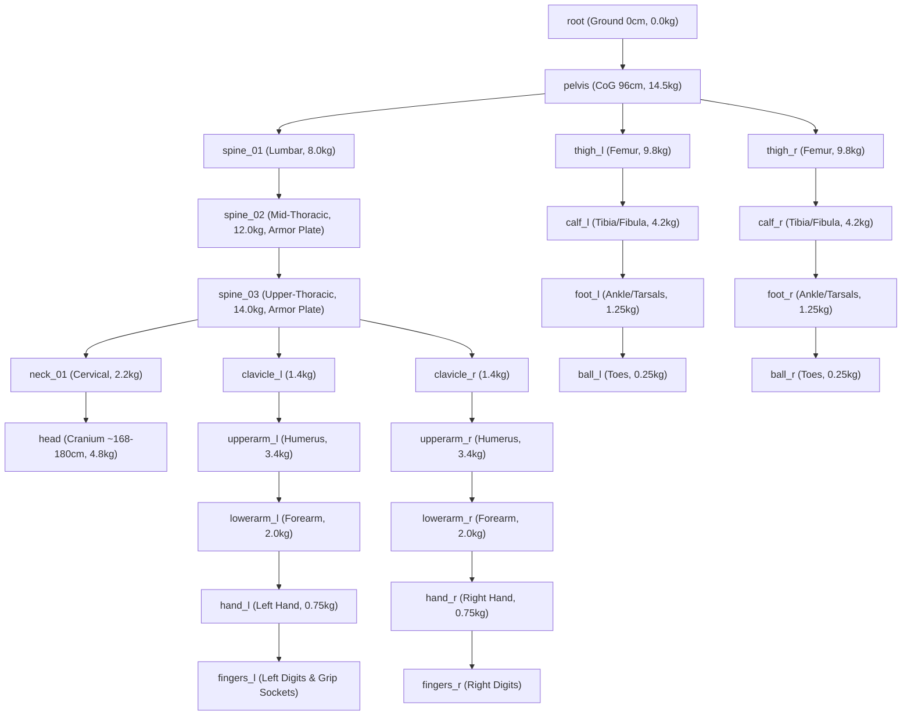

# Noble Fermi — Player Model, Skeletal Hierarchy, & Animation Architecture

This document provides a technical reference for Noble Fermi's player character model, skeletal bone hierarchy, procedural mechanics, and locomotion animation pipeline. It details how the current system is constructed and serves as a blueprint for scaling into a photorealistic soldier mesh and motion pipeline.

---

## 1. Executive Summary & Model Specifications

The Noble Fermi player model is calibrated to anthropometric human male dimensions:
- **Reference Subject**: Adult Human Male (Military Spec-Ops standard)
- **Stature / Height**: 180.0 cm
- **Total Physical Mass**: ~82.0 kg (distributed anatomically across bone segments)
- **Eye Line / Camera Pivot**: ~168.0 cm (ADS focal line at ~140–145 cm)
- **Pelvic Center of Gravity (CoG)**: 96.0 cm above ground plane
- **Mesh Asset Path**: `/Game/Characters/BaseMale/SK_BaseMale` (`SK_BaseMale.fbx`)
- **Skeleton Asset Path**: `/Game/Characters/BaseMale/SK_BaseMale_Skeleton`
- **Animation Blueprint**: `/Game/Characters/BaseMale/ABP_BaseMale` (Class: [`UFPSAnimInstance`](file:///c:/Users/Boris/Documents/antigravity/noble-fermi/Source/NobleFermi/Character/FPSAnimInstance.h))

---

## 2. Anatomical Skeletal Hierarchy & Bone Registry

The bone structure is mapped to the Unreal Engine 5 humanoid standard and registered in [`FFPSHumanSkeleton`](file:///c:/Users/Boris/Documents/antigravity/noble-fermi/Source/NobleFermi/BodyMechanics/FPSHumanBones.h#L125-L147). Every bone contains physical simulation properties, ballistic hit multipliers, and joint constraints.

### 2.1 Complete Bone Tree

---

### 2.2 Bone Data, Ballistic Damage Zones, & Armor Coverage

| Bone Name | Anatomical Segment | Mass | Hitbox Capsule (R × H) | Dmg Mult | Damage Zone | Level IV Plate Protected |
| :--- | :--- | :--- | :--- | :--- | :--- | :---: |
| `root` | Ground Plane reference | 0.0 kg | 1.0 × 1.0 cm | 1.00× | LowerTorso | No |
| `pelvis` | Sacrum / Pelvic girdle | 14.5 kg | 15.0 × 14.0 cm | 1.00× | Pelvis | No |
| `spine_01` | Lumbar L1–L5 (Abdomen) | 8.0 kg | 14.0 × 12.0 cm | 1.00× | LowerTorso | No |
| `spine_02` | Mid-Thoracic T7–T12 | 12.0 kg | 16.0 × 14.0 cm | 1.15× | UpperTorso | **Yes** |
| `spine_03` | Upper Thoracic T1–T6 | 14.0 kg | 17.5 × 15.0 cm | 1.25× | UpperTorso | **Yes** |
| `neck_01` | Cervical C1–C7 | 2.2 kg | 7.0 × 8.0 cm | 2.00× | Neck | No |
| `head` | Cranium & Brain Stem | 4.8 kg | 9.0 × 11.0 cm | 2.50× | Head | No (Helmet) |
| `clavicle_l/r` | Collarbone & Acromion | 1.4 kg | 5.5 × 8.0 cm | 0.90× | UpperArms | Partial |
| `upperarm_l/r`| Humerus | 3.4 kg | 6.5 × 15.0 cm | 0.80× | UpperArms | No |
| `lowerarm_l/r`| Radius & Ulna | 2.0 kg | 5.0 × 13.0 cm | 0.70× | LowerArms | No |
| `hand_l/r` | Metacarpals & Phalanges | 0.75 kg | 4.5 × 8.0 cm | 0.50× | Hands | No |
| `thigh_l/r` | Femur & Quadriceps | 9.8 kg | 9.5 × 22.0 cm | 0.95× | Thighs | No |
| `calf_l/r` | Tibia & Fibula | 4.2 kg | 6.5 × 20.0 cm | 0.80× | Calves | No |
| `foot_l/r` | Tarsals & Calcaneus | 1.25 kg | 5.5 × 11.0 cm | 0.50× | Feet | No |
| `ball_l/r` | Metatarsals & Toes | 0.25 kg | 4.0 × 6.0 cm | 0.40× | Feet | No |

---

## 3. Weapon Sockets & Physical Sockets

The character and weapon meshes interact via dedicated sockets baked into the skeleton:

1. **`hand_r` / `weapon_r`**: Primary weapon master grip socket. The rifle receiver attaches here snapped with zero rotation/offset.
2. **`hand_l`**: Driven by the procedural Two-Bone IK solver targeting the rifle's handguard.
3. **Weapon Sockets on `SM_AK47`**:
   - `weapon_l_ik`: `(X=2.6, Y=-17.5, Z=-2.6)` — Support hand contact point on the lower handguard.
   - `Muzzle_Flash_Socket`: `(X=0.0, Y=-52.0, Z=2.4)` — Rotated `(-90°, 0°, 0°)` along barrel bore for tracers and muzzle flash particles.
   - `Ejection_Port_Socket`: `(X=2.2, Y=-4.0, Z=2.5)` — Brass shell ejection impulse origin.
4. **Gear Attachment Sockets on Character**:
   - `spine_03`: Level IV ceramic plate carrier and tactical chest rig anchor point.
   - `head`: Ballistic helmet and NVG quad-nod mount anchor point.

---

## 4. Animation Pipeline & Movement Telemetry

The animation system operates on a hybrid architecture combining authoring Blend Spaces, Layered Blend Per Bone, and C++ procedural IK / physics modifiers in [`UFPSAnimInstance`](file:///c:/Users/Boris/Documents/antigravity/noble-fermi/Source/NobleFermi/Character/FPSAnimInstance.cpp).

### 4.1 Authoritative Locomotion Tiers & Speed Thresholds

Locomotion animations transition based on [`UFPSCharacterMovementComponent`](file:///c:/Users/Boris/Documents/antigravity/noble-fermi/Source/NobleFermi/Character/FPSCharacterMovementComponent.h):

| Movement Mode | Speed ($V$) Threshold | Direction Angle ($\theta$) | Animation Asset Used |
| :--- | :--- | :--- | :--- |
| **Idle ADS** | $0 \le V < 15\text{ cm/s}$ | $0^\circ$ | `Anim_BaseMale_Idle_ADS` |
| **Crouch Idle** | $0 \le V < 15\text{ cm/s}$ ($bCrouch$) | $0^\circ$ | `Anim_BaseMale_Crouch_Idle` |
| **Walk Forward** | $15 \le V \le 450\text{ cm/s}$ | $-45^\circ \le \theta \le +45^\circ$ | `Anim_BaseMale_Walk` |
| **Walk Backwards**| $15 \le V \le 350\text{ cm/s}$ | $\vert\theta\vert > 135^\circ$ | `Anim_BaseMale_Walk_Backwards` |
| **Crouch Walk** | $15 \le V \le 260\text{ cm/s}$ | Full $360^\circ$ Blend | `Anim_BaseMale_Crouch_Walk` |
| **Tactical Run** | $450 < V \le 750\text{ cm/s}$ | $-60^\circ \le \theta \le +60^\circ$ | `Anim_BaseMale_Run` |
| **Sprint** | $750 < V \le 900\text{ cm/s}$ | $-25^\circ \le \theta \le +25^\circ$ | `Anim_BaseMale_Sprint` |
| **Tactical Slide**| $V > 950\text{ cm/s}$ (Sprint+Crouch)| Forward vector | `Anim_BaseMale_Slide` |
| **Jump / Fall** | In Air ($bIsFalling$) | N/A | `Anim_BaseMale_Jump_Loop` |
| **Low-Ready** | Weapon lowered in sprint | N/A | `Anim_BaseMale_LowReady` |

Blend Space Asset: `/Game/Characters/BaseMale/BS_BaseMale_Locomotion` (2D Direction vs. Speed blend space).

---

### 4.2 C++ Procedural Animation Solvers ([`UFPSAnimInstance`](file:///c:/Users/Boris/Documents/antigravity/noble-fermi/Source/NobleFermi/Character/FPSAnimInstance.cpp))

In addition to keyframed root motion and blend spaces, `UFPSAnimInstance::NativePostEvaluateAnimation` applies real-time biomechanical correction:

1. **Procedural Two-Bone IK (Left Hand Support)**:
   - Evaluates `SM_AK47`'s `weapon_l_ik` socket in world space.
   - Solves `AnimationCore::SolveTwoBoneIK` across `upperarm_l` $\to$ `lowerarm_l` $\to$ `hand_l` so the support hand remains clamped to the rifle handguard regardless of player pitch, breathing, or recoil.
2. **Thoracic Aim Pitch & Leaning**:
   - Player look pitch ($\pm 89^\circ$) is distributed progressively across `spine_01`, `spine_02`, and `spine_03` rather than a single joint snap, preventing spine deformation artifacts.
   - Movement velocity acceleration applies banking torque to `spine_02` via [`UFPSBodyMechanicsComponent`](file:///c:/Users/Boris/Documents/antigravity/noble-fermi/Source/NobleFermi/BodyMechanics/FPSBodyMechanicsComponent.cpp).
3. **Procedural Flinch & Aim Punch**:
   - Incoming kinetic impacts trigger bone-localized torque and a damped spring-damper camera recoil (`AimPunchVelocity`).
4. **Foot IK & Step Leveling**:
   - Performs line traces from `foot_l` and `foot_r` to ground surfaces to align ankle tilt with slopes and uneven terrain.

---

## 5. Shader, Mask, & Material Pipeline

The character mesh uses a unified multi-zone tactical PBR shader:
- **Master Material**: `/Game/Characters/BaseMale/Materials/M_Operator_BaseBody`
- **Shading Model**: `MSM_SUBSURFACE` (realistic subcutaneous dermal scattering)

### 5.1 Texture Masks & Channel Allocation

| Texture Asset | Channels / Format | Role |
| :--- | :--- | :--- |
| `T_Operator_Body_Mask` | `TC_MASKS` (RGBA) | **R**: Torso Combat Shirt **G**: Camouflage Ripstop (Limbs/Pants) **B**: Organic Human Skin (Face & Neck) **A**: Tactical Armor/Gear Harness |
| `T_Camo_Digital` | `TC_DEFAULT` (RGB) | Multi-frequency dual-tone pixelated tactical camo pattern |
| `T_Ripstop_Normal` | `TC_NORMALMAP` | High-frequency 5mm ripstop textile grid weave normal |
| `T_Ripstop_Roughness` | `TC_MASKS` (Grayscale) | Textile micro-roughness (calibrated 0.72–0.82) |

---

## 6. 7-Zone Socket-Driven 3D Tactical Armor Rig ([`UFPSOperatorGearComponent`](file:///c:/Users/Boris/Documents/antigravity/noble-fermi/Source/NobleFermi/Character/FPSOperatorGearComponent.h))

To transform `SK_BaseMale` into the heavily armored **Task Force Echo Operator** while maintaining 100% compatibility with the 21-bone `FFPSHumanSkeleton` and `UFPSAnimInstance` C++ solvers, [`UFPSOperatorGearComponent`](file:///c:/Users/Boris/Documents/antigravity/noble-fermi/Source/NobleFermi/Character/FPSOperatorGearComponent.cpp) constructs and pins 12 multi-section `UProceduralMeshComponent` assemblies across all 7 anatomical loadout zones:

| Zone | Target Bone(s) | Procedural Mesh Component | 3D Hard-Surface & Tactical Loadout Geometry |
| :--- | :--- | :--- | :--- |
| **Zone 1** | `head` | `HeadGearProcMesh` | Matte black tactical balaclava hood & mandible guard, exposed **Eye/Brow Facial Skin Strip (`#B88B72`)** with recessed dark orbital eye shadowing & nose bridge, wrap-around **Ballistic Eye Shield / Goggles**, **FAST Ops-Core High-Cut Ballistic Helmet**, Wilcox NVG shroud + toggleable **GPNVG-18 Quad-Nod NVGs**, and **Peltor ComTac Headset** with boom mic. |
| **Zone 2** | `spine_03` / `spine_02` | `TorsoGearProcMesh` | **360° Padded Ballistic Collar / Neck Yoke** (concealing the neck-to-torso seam), beveled octagonal **Level IV Ceramic Plate Carrier** (`+5.0 cm` chest / `+4.5 cm` back protrusion), padded shoulder straps, cummerbund side-SAPI plates, upper-chest Velcro placard with extruded 3D **`NOBLE FERMI`** yellow-amber tactical stencil lettering (`#F2C84B`), **3 vertical rifle magazine pouches**, PTT radio box, and whip antenna. |
| **Zone 3** | `upperarm_l`, `upperarm_r` | `LeftPauldronProcMesh`, `RightPauldronProcMesh` | BDU upper-sleeve pocket bulk + articulated **Deltoid Ballistic Shoulder Pauldrons** widening each shoulder by `+3.8 cm` with Velcro unit patch bezels and bicep retention straps. |
| **Zone 4** | `lowerarm_l/r`, `hand_l/r` | `LeftForearmProcMesh`, `RightForearmProcMesh`, `LeftGloveProcMesh`, `RightGloveProcMesh` | Bloused BDU forearm cuffs, articulated elbow guards, molded forearm vambraces + **Wrist GPS Display** on `lowerarm_l`, and **Reinforced Carbon-Knuckle Combat Gloves** over `hand_l` and `hand_r`. |
| **Zone 5** | `pelvis` | `BattleBeltProcMesh` | Heavy 2-piece **MOLLE Tactical War-Belt** (`Z = 96 cm`), Cobra metal buckle, **Trapezoidal Ballistic Groin/Lap Protector Pad**, double Kydex pistol mag pouches, rolled nylon dump pouch, and rear blowout IFAK med-pouch. |
| **Zone 6** | `thigh_r`, `thigh_l` | `RightThighProcMesh`, `LeftThighProcMesh` | BDU cargo trouser bulk + **Drop-Leg Kydex Sidearm Holster & Holstered 9mm Tactical Pistol** with dual horizontal thigh straps on `thigh_r`, and **Drop-Leg Tactical Sub-Load / Breaching Rig** on `thigh_l`. |
| **Zone 7** | `calf_l`, `calf_r` | `LeftCalfProcMesh`, `RightCalfProcMesh` | Articulated **Hard-Shell Polymer Knee Pads** with upper/lower neoprene straps at the knee joint (`Z = 52 cm`), bloused BDU lower-leg cuffs, and **Heavy Reinforced Combat Boot Uppers, Heel Counters & Armored Toe Caps** down to the ankles/feet. |
| **Weapon** | `hand_r` $\to$ `hand_l` | `CarbineProcMesh` | 1:1 scale **Spec-Ops M-LOK Tactical Carbine** (billet receiver, collapsible crane stock, curved 30-round PMAG, EOTech EXPS3 holographic sight, AN/PEQ-15 laser module, QD suppressor, and angled foregrip) locked between `hand_r` (pistol grip) and `hand_l` (foregrip). |

### 6.1 `100x` FBX Bone-Scale Immunity Architecture
Because `SK_BaseMale.fbx` was authored in Blender in meters (`1.80m`) and imported into Unreal Engine centimeters (`180 cm`), the armature bones carry an internal `100.0` scale factor (`Scale3D = (100, 100, 100)`). Attaching child components directly to a bone socket causes them to inherit `100x` scaling.
- **Solution**: All 12 `UProceduralMeshComponent` gear zones (and `CarbineProcMesh`) attach to the unscaled actor root (`TurntableRoot` on [`AFPSCharacterPreviewActor`](file:///c:/Users/Boris/Documents/antigravity/noble-fermi/Source/NobleFermi/Character/FPSCharacterPreviewActor.cpp) or `GetCapsuleComponent()` on [`AFPSCharacter`](file:///c:/Users/Boris/Documents/antigravity/noble-fermi/Source/NobleFermi/Character/FPSCharacter.cpp)), and `UFPSOperatorGearComponent::UpdateGearTransforms()` pins each mesh every frame in World Space using `BodyMesh->GetBoneLocation(BoneName, EBoneSpaces::WorldSpace)` and orthonormalized parent-to-child limb vectors (`FRotationMatrix::MakeFromYZ`) with `WorldScale3D = (1, 1, 1)`.

### 6.2 Menu Low-Ready Carbine Stance & Camera Framing
- **Authoritative Low-Ready Pose (`UFPSAnimInstance`)**: When owned by `AFPSCharacterPreviewActor` (`bIsMenuPreview = true`, `MenuPoseIndex = 0`), `UFPSAnimInstance` poses the Operator in a grounded shoulder-width stance with slow `0.25 Hz` chest respiration, `-3.0°` chin tuck, right hand gripping the carbine pistol grip in front of the right pectoral, and left hand solved via Two-Bone IK onto the forward handguard along a `-36°` downward / `-28°` cross-body diagonal.
- **Full-Figure Menu Camera Framing**: `PreviewCamera` is positioned at `Location = (335.0, 0.0, 126.0)`, `Rotation = (-1.6°, 180.0°, 0.0°)`, `FieldOfView = 54.0°` (`DepthOfFieldFocalDistance = 335.0 cm`), framing the Operator from mid-shin (`Z = 20.6 cm`, below the knee pads) to `Z = 202.1 cm` (`~19 cm` of clean headroom above the FAST ballistic helmet crown and beneath the Top Status Bar).

---

## 7. Roadmap to AAA Photorealistic Soldier

To advance from the current `SK_BaseMale` + `UFPSOperatorGearComponent` setup to an artist-authored photogrammetry operative, follow this upgrade path:

1. **High-Poly Sculpt & Topology**:
   - Retain current skeleton bone naming (`root`, `pelvis`, `spine_01..03`, `clavicle_l/r`, `head`, etc.) to preserve 100% compatibility with all C++ IK solvers, damage zoning, and hit registration.
   - Integrate 4K UDIMs for Head/Face (pores, micro-wrinkles, subsurface maps) and Body/Gear.
2. **Modular Tactical Gear Slots**:
   - Replace individual `UProceduralMeshComponent` zones in `UFPSOperatorGearComponent` with nanite-ready artist static/skeletal meshes while keeping the exact same bone-pinning transform pipeline.
3. **Secondary Physics & Clothing Simulation**:
   - Add Chaos Cloth assets on pants hems, antenna, and chest rig straps.
4. **Facial Rigging**:
   - Add Apple ARKit 52-blendshape standard or Metahuman bone hierarchy on the `head` bone for combat vocalizations, exertion, and grimaces.
